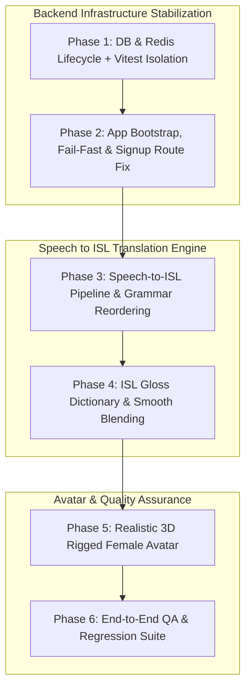

# Missing Whisper — Comprehensive Implementation Plan

> **Document Version:** 1.0.0  
> **Target Branch:** `sawanmani`  
> **Source Analysis:** [Missing_Whisper_Bug_Report_Fix_Plan.md](./Missing_Whisper_Bug_Report_Fix_Plan.md)  
> **Author:** Antigravity AI Assistant  
> **Date:** October 13, 2026

---

## 1. Executive Summary & Root Cause Analysis

Missing Whisper ke integration tests aur pipeline me 3 cascading critical issues aur 3 core-feature improvement areas identify hue hain:

```
[Redis Connection Drops / Offline Queue Disabled]
                  │
                  ▼
[RateLimiter Middleware Bug: next(next()) executes]
                  │
                  ▼
[App Fails to Route Requests Properly -> 404 on /signup]
                  │
                  ▼
[Tests Fail -> afterAll closes Postgres Pool]
                  │
                  ▼
[Singleton Pool Reused in Subsequent Test -> "Cannot use a pool after calling end"]
```

### Summary of Identified Bugs:

| ID | Component | Error Observed | Root Cause in Codebase |
|---|---|---|---|
| **BUG-01** | Test Runner & Vitest | `Cannot use a pool after calling end on the pool` | `getDatabase().close()` calls `pool.end()`, but singleton `instance` in `apps/api/src/infra/db/index.ts` is not reset to `null`. Tests running in the same process reuse the dead pool. |
| **BUG-02** | Postgres Migration Schema | Query error on inserting `confidence: null` | In `apps/api/src/infra/db/postgres.ts`, `transcripts` table has `confidence numeric NOT NULL`, but `postgres.integration.test.ts` tests inserting explicit `null` confidence. |
| **BUG-03** | Redis Client Driver | `Stream isn't writeable and enableOfflineQueue options is false` | In `apps/api/src/infra/redis/client.ts`, `enableOfflineQueue: false` and `lazyConnect: false` are set without any `retryStrategy`. |
| **BUG-04** | RateLimiter Middleware | 404 / unpredictable routing during error | In `apps/api/src/middleware/rateLimit.ts` line 24: `next(err instanceof AppError ? err : next())` calls `next()` twice or passes undefined to error handler. |
| **BUG-05** | Core NLP / ISL Pipeline | SVO vs SOV grammar ordering & accuracy | `apps/web/src/lib/translation` needs robust ISL grammar restructuring (Subject-Object-Verb, Wh-words at end, time markers initial, non-manual markers). |
| **BUG-06** | Avatar & Hands Rig | Low-poly / generic motion primitives | Placeholder gestures (`wave`, `raise-left`) and generic skeleton in `apps/web/src/lib/avatar` need realistic rigged female character with detailed 15-20 finger bones per hand. |

---

## 2. Phased Roadmap Overview



---

## 3. Detailed Phase Specifications

---

### Phase 1: Stabilize Test Infrastructure (DB + Redis Lifecycle)

#### 1.1 Goals
- Prevent state leaks across test workers.
- Ensure proper lifecycle management for Postgres connection pool.
- Enable automatic reconnection and offline queuing for Redis.
- Fix database schema constraints to allow genuine `null` confidence.

#### 1.2 Target Files
- `apps/api/vitest.integration.config.ts`
- `apps/api/src/infra/db/index.ts`
- `apps/api/src/infra/db/postgres.ts`
- `apps/api/src/infra/redis/client.ts`
- `apps/api/src/test/setup.integration.ts`

#### 1.3 Detailed Changes

##### A. Vitest Config (`apps/api/vitest.integration.config.ts`)
Set worker isolation using `forks` with single fork mode to ensure deterministic sequential execution:
```typescript
export default defineConfig({
  test: {
    environment: 'node',
    globals: true,
    setupFiles: ['src/test/setup.integration.ts'],
    include: ['src/**/*.integration.test.ts'],
    pool: 'forks',
    poolOptions: {
      forks: {
        singleFork: true,
      },
    },
    fileParallelism: false,
    testTimeout: 30_000,
    hookTimeout: 30_000,
  },
});
```

##### B. DB Lifecycle & Schema (`apps/api/src/infra/db/postgres.ts` & `index.ts`)
1. In `apps/api/src/infra/db/postgres.ts`:
   - Change `transcripts` table schema:
     ```sql
     -- BEFORE:
     confidence numeric NOT NULL,
     -- AFTER:
     confidence numeric,
     ```
   - Update `close()` method:
     ```typescript
     async close(): Promise<void> {
       if (pool) {
         await pool.end();
       }
     }
     ```
2. In `apps/api/src/infra/db/index.ts`:
   - Ensure `resetDatabaseForTests()` resets the singleton:
     ```typescript
     export function resetDatabaseForTests(): void {
       instance = null;
     }
     ```

##### C. Redis Reconnection Strategy (`apps/api/src/infra/redis/client.ts`)
Add exponential backoff `retryStrategy`, enable offline queue, and lazy connect:
```typescript
export function createRedisKVStore(url: string): KVStore {
  const client = new Redis(url, {
    maxRetriesPerRequest: 3,
    enableOfflineQueue: true,
    lazyConnect: true,
    retryStrategy(times) {
      const delay = Math.min(times * 100, 3000);
      return delay;
    },
    reconnectOnError(err) {
      const targetErrors = ['READONLY', 'ECONNRESET', 'ETIMEDOUT'];
      return targetErrors.some((target) => err.message.includes(target));
    },
  });

  client.on('error', (err) => logger.error('redis_error', { message: err.message }));

  // Connect explicitly when store is initialized
  client.connect().catch((err) => {
    logger.warn('redis_initial_connect_failed', { message: err.message });
  });

  return {
    driver: 'redis',
    // ... existing methods ...
    async close() {
      await client.quit().catch(() => client.disconnect());
    },
  };
}
```

#### 1.4 Verification Command
```powershell
npm --prefix apps/api run test:integration
```
*Criteria:* All 3 tests in `postgres.integration.test.ts` pass without `pool.end` or Redis stream errors.

---

### Phase 2: Fix App Bootstrap & 404 on Signup

#### 2.1 Goals
- Fix double-call / undefined dispatch in rate-limiting middleware.
- Ensure fail-fast startup semantics if dependencies are misconfigured.
- Provide comprehensive health-check endpoints reflecting Postgres and Redis statuses.

#### 2.2 Target Files
- `apps/api/src/middleware/rateLimit.ts`
- `apps/api/src/routes/v1/health.routes.ts`
- `apps/api/src/app.ts`

#### 2.3 Detailed Changes

##### A. Rate Limiter Middleware (`apps/api/src/middleware/rateLimit.ts`)
Fix invalid `next(err instanceof AppError ? err : next())`:
```typescript
// BEFORE:
} catch (err) {
  next(err instanceof AppError ? err : next());
}

// AFTER:
} catch (err) {
  if (err instanceof AppError) {
    return next(err);
  }
  // Fail-open for infrastructure errors (Redis down) but log warning
  logger.warn('rate_limiter_store_error_failing_open', {
    error: (err as Error).message,
  });
  return next();
}
```

##### B. Health Check Endpoints (`apps/api/src/routes/v1/health.routes.ts`)
Ensure `/api/v1/health` and `/api/v1/health/ready` check both DB and KVStore:
```typescript
healthRouter.get('/ready', async (_req, res) => {
  const dbHealth = await getDatabase().health();
  const kvHealth = await getKVStore().health();

  const isHealthy = dbHealth.ok && kvHealth.ok;
  res.status(isHealthy ? 200 : 503).json({
    status: isHealthy ? 'ready' : 'degraded',
    services: {
      database: dbHealth,
      kvStore: kvHealth,
    },
    timestamp: new Date().toISOString(),
  });
});
```

#### 2.4 Verification
- Run integration tests with valid credentials against `/api/v1/auth/signup`.
- Test `/api/v1/health/ready` returning `{ status: 'ready', services: { database: { ok: true }, kvStore: { ok: true } } }`.

---

### Phase 3: Speech-to-ISL Core Pipeline Audit

#### 3.1 Goals
- Trace and benchmark Speech-to-Text accuracy for English (`en-IN`) and Hindi (`hi-IN`).
- Implement Indian Sign Language (ISL) grammar rules (SOV order, Wh-question movement, negation syntax, time-adverbial positioning).
- Introduce structured telemetry logging at each stage of the pipeline.

#### 3.2 Target Files
- `apps/web/src/features/useSpeechRecognition.ts`
- `apps/web/src/lib/speech/webSpeechProvider.ts`
- `apps/web/src/lib/translation/wordMapper.ts`
- `apps/web/src/lib/translation/conceptBuilder.ts`
- `apps/web/src/lib/translation/types.ts`

#### 3.3 ISL Grammar Transformation Rules
ISL has fundamentally distinct syntax compared to spoken English:
1. **Sentence Word Order:** English uses **SVO** (*Subject-Verb-Object*), whereas ISL follows **SOV** (*Subject-Object-Verb*).
   - *English:* "I eat an apple"
   - *ISL Gloss:* `ME APPLE EAT`
2. **Wh-Questions:** Question words (*WHO, WHAT, WHERE, WHEN, WHY, HOW*) appear at the **end** of the sentence in ISL.
   - *English:* "What is your name?"
   - *ISL Gloss:* `YOUR NAME WHAT`
3. **Time Markers:** Time references occur at the very **beginning** to set temporal context.
   - *English:* "I will go tomorrow"
   - *ISL Gloss:* `TOMORROW ME GO`
4. **Negation:** Negative markers (*NO, NOT, NEVER*) typically follow the verb.
   - *English:* "I do not understand"
   - *ISL Gloss:* `ME UNDERSTAND NOT`

#### 3.4 Verification
- Add test suites in `apps/web/src/lib/translation/wordMapper.test.ts` checking:
  - `"What is your name"` -> `[YOUR, NAME, WHAT]`
  - `"Yesterday I went to school"` -> `[YESTERDAY, ME, SCHOOL, GO]`
  - `"I do not know"` -> `[ME, KNOW, NOT]`

---

### Phase 4: ISL Gloss Dictionary & Animation Accuracy

#### 4.1 Goals
- Expand the curated lexicon with standard ISL vocabulary.
- Integrate automatic fingerspelling fallback for unrecognized proper nouns / technical words.
- Implement smooth interpolation (SLERP) and gesture blending between consecutive signs.

#### 4.2 Target Files
- `apps/web/src/lib/translation/glossary.ts`
- `apps/web/src/lib/avatar/animationController.ts`
- `apps/web/src/lib/avatar/animationQueue.ts`
- `apps/web/src/lib/avatar/gestureMapper.ts`

#### 4.3 Detailed Changes
1. **Expanded Glossary (`glossary.ts`):**
   - Incorporate categories: Emergency, Healthcare, Banking, Education, Greetings, Family relations, Directions.
   - Add finger-spelling character map (`A-Z`, `0-9`).
2. **Smooth Transition Blending (`animationController.ts`):**
   - Introduce cross-fade duration parameter (default: 150ms-250ms).
   - Rest pose return: Between disparate sign families, gracefully return hands to neutral ready-state to avoid visual snapping.

---

### Phase 5: Avatar Upgrade (Realistic 3D Female Character)

#### 5.1 Goals
- Replace low-poly / placeholder mesh with a high-fidelity rigged female character.
- Ensure anatomically complete finger rigging (minimum 15-20 bones per hand: Thumb, Index, Middle, Ring, Pinky with Proximal, Intermediate, Distal phalanges).
- Export as optimized `.glb` / `.gltf` with PBR materials for Babylon.js.

#### 5.2 Target Files & Assets
- `apps/web/public/assets/avatar/` (Avatar GLB files)
- `apps/web/src/lib/avatar/avatarLoader.ts`
- `apps/web/src/lib/avatar/gestureMapper.ts`
- `apps/web/src/features/useAvatar.ts`

#### 5.3 Avatar Specifications
- **Model Generation Source:** Ready Player Me (realistic female preset) or MakeHuman/Blender custom rig.
- **Mesh Limits:** < 45,000 polygons for smooth 60fps web rendering on mobile/laptop GPUs.
- **Bone Hierarchy:**
  - Arm: `Shoulder -> UpperArm -> Forearm -> Wrist`
  - Hand (Per Hand):
    - Thumb: `ThumbMetacarpal -> ThumbProximal -> ThumbDistal`
    - Fingers (Index, Middle, Ring, Pinky): `Metacarpal -> Proximal -> Intermediate -> Distal`
  - Facial Blendshapes: `Blink`, `EyebrowsUp`, `EyebrowsDown`, `MouthOpen`, `Smile`, `Frown` (for ISL non-manual markers).

---

### Phase 6: End-to-End QA & Regression Suite

#### 6.1 Goals
- Implement automated end-to-end integration test spanning: `Audio/Text Input -> STT -> ISL Grammar Translation -> Gloss Events -> Avatar Command Execution`.
- Add headless CI tests for WebGL canvas without requiring a physical GPU.

#### 6.2 Target Files
- `apps/api/src/test/e2e.test.ts`
- `apps/web/src/test/e2e-pipeline.test.ts`
- `.github/workflows/ci.yml`

#### 6.3 Verification Checklist
- [ ] Postgres integration tests pass cleanly (`npm run test:integration`).
- [ ] Redis handles disconnect/reconnect scenarios without unhandled rejections.
- [ ] Signup route handles rate limiting smoothly without 404s.
- [ ] SVO to SOV grammar converter accurately formats sentences.
- [ ] Avatar viewer renders realistic hand shapes without mesh deformation.
- [ ] Full monorepo passes `npm run lint` and `npm run build`.

---

## 4. Execution Order & Next Action Items

We recommend executing strictly in the following priority order:

1. **Immediate Step (P1):** Apply Postgres pool singleton fix, Redis retry/offline options, and schema fix for `confidence`. Run `npm run test:integration`.
2. **Immediate Step (P2):** Fix `rateLimit.ts` middleware bug and verify `/api/v1/auth/signup`.
3. **Step 3 (P3 & P4):** Implement SOV grammar ordering in `conceptBuilder.ts` and expand glossary.
4. **Step 4 (P5 & P6):** Import rigged 3D female avatar asset and run full end-to-end integration suite.
